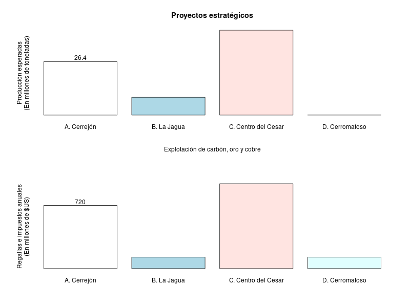
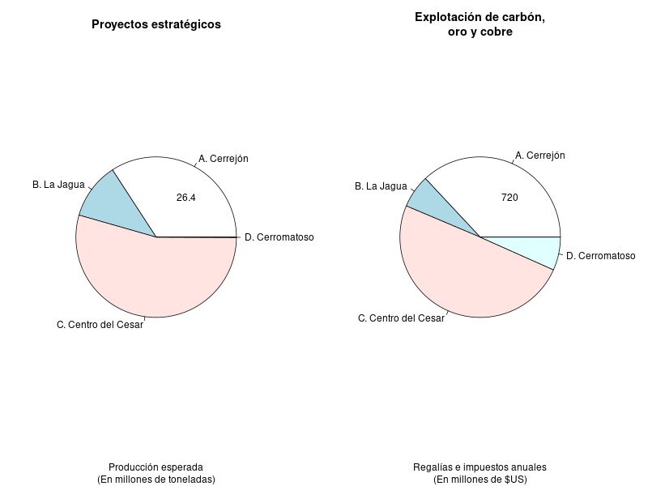
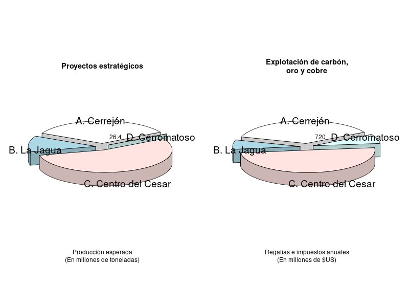
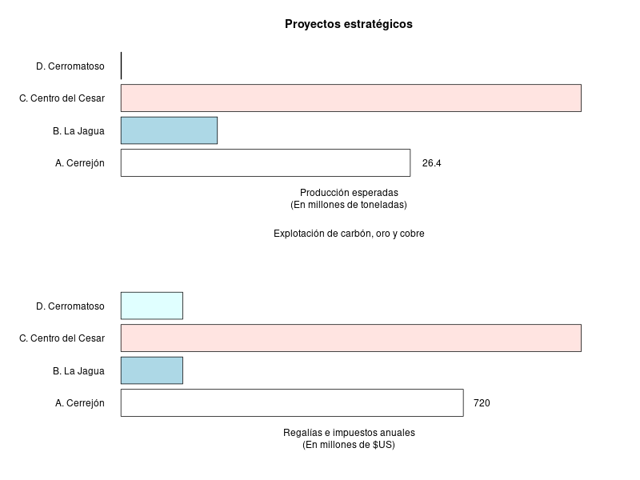
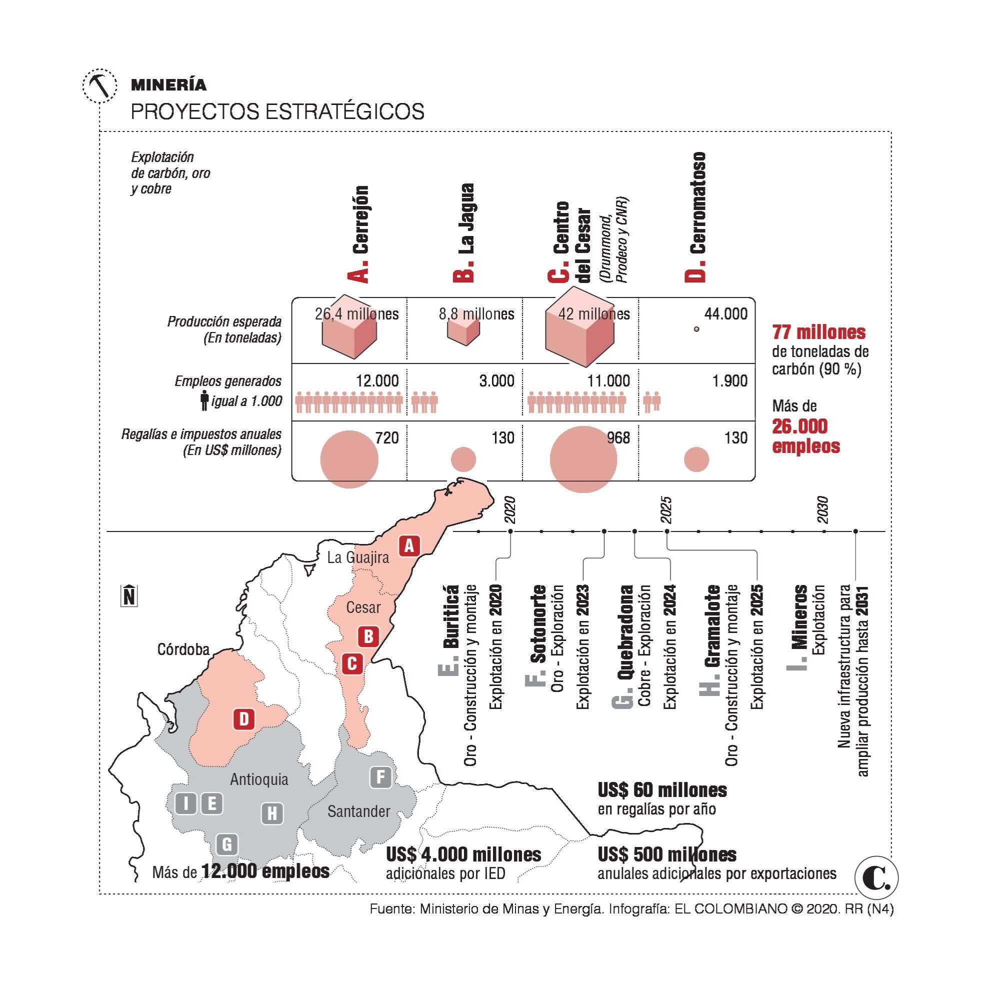

# Presentación

- Estadística Descriptiva y Análisis Exploratorio de Datos
- Universidad Nacional de Colombia sede Medellín
- Semestre 2021-02

### Miembros del equipo

- Andrés Felipe Aparicio Mestre - [anapariciom@unal.edu.co](mailto:anapariciom@unal.edu.co)
- Emmanuel López Rodríguez - [emlopezr@unal.edu.co](mailto:emlopezr@unal.edu.co)
- José David Cardona Soto - [jcardonaso@unal.edu.co](mailto:jcardonaso@unal.edu.co)
- Jerónimo Gómez Restrepo - [jegomezre@unal.edu.co](mailto:jegomezre@unal.edu.co)
- Samuel Alahín López Cadavid - [samlopez@unal.edu.co](mailto:samlopez@unal.edu.co)

# Introducción y contextualización  
En el articulo titulado [La minería: un debate entre el riesgo y su aporte](https://www.elcolombiano.com/negocios/economia/mineria-que-tanto-afecta-al-medioambiente-EB13561207) del periódico el Colombiano, aseguran que promover la minería legal en Colombia traerá mayores empleos para la población, mayor inversión en el país y numerosos ingresos económicos gracias a la actividad extractiva minera. Durante años se ha creído que la minería trae consigo grandes afectaciones ambientales, por la contaminación de fuentes hídricas y del suelo, y a partir de esto afectaciones para la salud, sin embargo profesores y geólogos aseguran que estás afirmaciones son falsas, ya que con el avance tecnológico de hoy en día, estas afectaciones son mitigadas y el impacto ambiental es casi nulo.

En el documento se muestra un gráfico de cubos y círculos, el cuál provee información acerca de la producción esperada (En toneladas) de mineral, los empleos generados y los ingresos anuales por regalías e impuestos anuales para el país (en US$ millones), en algunas minas importantes del país las cuales son: El Cerrejón, La Jagua, Centro del Cesar y Cerromatoso. De esta forma se argumenta la promoción de la minería.

Inicialmente se les presentó a los estudiantes dos gráficos, solo con el valor de la producción esperada o de las regalías de la mina El Cerrejón, y a partir de este valor debían de estimar a ojo el correspondiente valor para las demás minas.

Una de las gráficas correspondía a la producción esperada y la otra a las regalías e impuestos anuales. Las gráficas podían ser de los siguientes 5 tipos: círculos y cubos, barras verticales, pasteles, pasteles 3D y barras horizontales. Se hizo la recolección de las respuestas de los estudiantes, y a partir de estos datos se debía realizar un análisis exploratorio. A continuación se muestran algunos registros de la base de datos original:  

```{r setup, include=FALSE}
knitr::opts_chunk$set(echo = FALSE)
options(width = 100)
```

```{r, include=FALSE}
# CARGA DE LIBRERÍAS USADAS
library(readr)
library(dplyr)
library(kableExtra)
library(tidyverse)
library(plotly)

# CARGA DE LA BASE DE DATOS
basePercepcionOriginal <- read_csv("base_percepcion.csv")
basePercepcionCorregida <- basePercepcionOriginal # Copiar la base de datos para tener la original y la corregida
```

```{r, echo=FALSE}
nombresNuevosColumnasKnit <- c('Enviado', 'Completado', 'Q1','Q2', 'Q3', 'Q4', 'Q5', 'Q6', 'Grupo')
colnames(basePercepcionOriginal) <- nombresNuevosColumnasKnit #Renombrar columnas para estética en el Knit
head(basePercepcionOriginal) %>% kbl() %>% kable_material(c("striped", "hover"))
```

*Cabe recalcar que por la estética del informe se cambiaron los nombres de las columnas de la base de datos original antes de imprimirla*

# Depuración de la base de datos

Como podemos observar en la base de datos original se cuentan con 9 columnas, pero llegamos a la conclusión que para el estudio que se va a realizar a partir de esta, son inservibles 2 de ellas. Las columnas que eliminaremos son:

- **Enviado:** Que nos dice la hora a la cual el estudiante envió sus respuestas al sistema, en este estudio no nos enfocaremos en el tiempo que les tomó a los estudiantes responder, si no en sus respuestas.

- **Completado:** Que nos indica si el estudiante envió sus respuestas al sistema. En esta columna todos los estudiantes tienen el valor de *"y"*, el cual indica que enviaron la prueba, por lo que no nos es relevante esta información.

También, notamos que una de las filas de la base de datos contenía solo uno de sus campos con información, el resto estaban vacíos *(Valor NA)*. Por tanto decidimos eliminarla.

Posteriormente, decidimos por cambiar el nombre de las columnas que nos quedaban. Esto, para facilitarnos el trabajo a la hora de necesitar referenciarlas dentro del código.

Por último, optamos por mover la columna **"Grupo"** al primer lugar de la base de datos, ya que próximamente será una variable muy importante dentro del estudio

```{r, include=FALSE}
# DEPURACIÓN DE LA BASE DE DATOS

basePercepcionCorregida <- basePercepcionCorregida[-c(37),] # Fila vacía eliminada
basePercepcionCorregida <- subset(basePercepcionCorregida, select = -c(Enviado.el.,Completado)) # Columnas innecesarias eliminadas
basePercepcionCorregida <- basePercepcionCorregida %>% relocate(grupo, .before = Q01_B..La.Jagua) # Mover columna grupo al inicio
nombresNuevosColumnas <- c('Grupo','Q1_LaJagua','Q2_CentroDelCesar', 'Q3_Cerromatoso', 'Q4_LaJagua', 'Q5_CentroDelCesar', 'Q6_Cerromatoso')
colnames(basePercepcionCorregida) <- nombresNuevosColumnas #Renombrar columnas
```

```{r, echo=FALSE}
head(basePercepcionCorregida) %>% kbl() %>% kable_material(c("striped", "hover"))
```

### Corrección de datos atípicos

Ahora, notamos que dentro de las respuestas de los estudiantes existen datos atípicos que, de no ser tratados afectarán nuestras conclusiones del estudio. Para mostrar esto, haremos un *Summary* de la base de datos

```{r}
summary(basePercepcionCorregida)
```

Como se puede observar, hay estudiantes que suministraron los datos en proporciones erroneas. Durante el transcurso de la prueba, se indicó que los datos en millones se debían de escribir de manera resumida *(Ejemplo: "26.4" en lugar de "26'400.000")* y los datos con parte fraccionaria debían ser separados con punto, sin embargo, algunos estudiantes hicieron caso omiso de las indicaciones, por lo que se presentan datos atípicos muy grandes en comparación a la media de la columna. Tratamos esos datos dándoles una proporción que los ajustara mucho mejor a la media de la columna.

También, notamos casos puntuales donde se trucaba la respuesta de una pregunta con otra sucesiva a ella *(Ejemplo: Respuesta de Q2 en Q3 y viceversa)*, por lo que para no desperdiciar los datos de estos estudiantes, optamos por mover manualmente los valores entre columnas en los que al hacer el análisis calzaban perfectamente dentro de la media.

```{r, include=FALSE}
# CORRECCIÓN DE DATOS ATÍPICOS

## Correción de estudiante que suministró los datos de Q1, Q2 y Q3 en millones completos (Lo convertimos al formato general)
basePercepcionCorregida$Q1_LaJagua[basePercepcionCorregida$Q1_LaJagua == 13200000] <- 13200000/10^6
basePercepcionCorregida$Q2_CentroDelCesar[basePercepcionCorregida$Q2_CentroDelCesar == 39600000] <- 39600000/10^6
basePercepcionCorregida$Q3_Cerromatoso[basePercepcionCorregida$Q3_Cerromatoso == 1320000] <- 1320000/10^6

## Correción de estudiante que suministró los datos de Q2 con más ceros de lo esperado (Lo convertimos al formato general)
basePercepcionCorregida$Q2_CentroDelCesar[basePercepcionCorregida$Q2_CentroDelCesar == 52000] <- 52000/10^3

## Correción de estudiante que suministró los datos de Q2 con menos ceros de lo esperado (Lo convertimos al formato general)
basePercepcionCorregida$Q2_CentroDelCesar[basePercepcionCorregida$Q2_CentroDelCesar == 4] <- 4*10
basePercepcionCorregida$Q2_CentroDelCesar[basePercepcionCorregida$Q2_CentroDelCesar == 4.2] <- 4.2*10

## Correción de estudiantes que en las preguntas Q2 y Q3 truncaron sus respuestas (Respuesta de Q2 en Q3 y viceversa)
basePercepcionCorregida$Q2_CentroDelCesar[basePercepcionCorregida$Q2_CentroDelCesar == 0.5] <- 44
basePercepcionCorregida$Q2_CentroDelCesar[basePercepcionCorregida$Q2_CentroDelCesar == 1.4] <- 37
basePercepcionCorregida$Q3_Cerromatoso[basePercepcionCorregida$Q3_Cerromatoso == 44] <- 0.5
basePercepcionCorregida$Q3_Cerromatoso[basePercepcionCorregida$Q3_Cerromatoso == 37] <- 1.4

## Correción de estudiante que suministró los datos de Q4, Q5 y Q6 con 2 ceros de más (Lo convertimos al formato general)
basePercepcionCorregida$Q4_LaJagua[basePercepcionCorregida$Q4_LaJagua == 15000] <- 15000/10^2
basePercepcionCorregida$Q5_CentroDelCesar[basePercepcionCorregida$Q5_CentroDelCesar == 50000] <- 50000/10^2
basePercepcionCorregida$Q6_Cerromatoso[basePercepcionCorregida$Q6_Cerromatoso == 4000] <- 4000/10^2

# Correción de estudiante que suministró los datos de Q5 con menos ceros de lo esperado (Lo convertimos al formato general)
basePercepcionCorregida$Q5_CentroDelCesar[basePercepcionCorregida$Q5_CentroDelCesar == 100] <- 100*10

# Correción de estudiantes que en las preguntas Q5 y Q6 truncaron sus respuestas (Respuesta de Q5 en Q6 y viceversa)
basePercepcionCorregida$Q5_CentroDelCesar[basePercepcionCorregida$Q5_CentroDelCesar == 90] <- 900
basePercepcionCorregida$Q5_CentroDelCesar[basePercepcionCorregida$Q5_CentroDelCesar == 115] <- 850
basePercepcionCorregida$Q5_CentroDelCesar[basePercepcionCorregida$Q5_CentroDelCesar == 150] <- 1014
basePercepcionCorregida$Q6_Cerromatoso[basePercepcionCorregida$Q6_Cerromatoso == 900] <- 90
basePercepcionCorregida$Q6_Cerromatoso[basePercepcionCorregida$Q6_Cerromatoso == 850] <- 115
basePercepcionCorregida$Q6_Cerromatoso[basePercepcionCorregida$Q6_Cerromatoso == 1014] <- 150
```

Luego de hacer toda la depuración, observaremos de nuevo el *Summary* de la base de datos corregida. Donde se puede analizar que ahora los datos extremos de cada columna están mucho más cerca entre si y la media de las columnas es un valor mucho más realista.

```{r}
summary(basePercepcionCorregida)
```

La base de datos depurada. Nos queda de la siguiente manera:

```{r}
head(basePercepcionCorregida) %>% kbl() %>% kable_material(c("striped", "hover"))
```

# Comparación del desempeño en la percepción de las gráficas

```{r, include=FALSE}
# SUMMARYS DE LAS BASES DE DATOS ORIGINAL Y CORREGIDA PARA COMPRARAR

summaryBaseOriginal <- summary(basePercepcionOriginal)
summaryBaseCorregida <- summary(basePercepcionCorregida)

# DISCRETIZACIÓN POR GRUPOS PARA EL ANÁLISIS 

grupo1 <- basePercepcionCorregida[basePercepcionCorregida$Grupo==1,]
grupo2 <- basePercepcionCorregida[basePercepcionCorregida$Grupo==2,]
grupo3 <- basePercepcionCorregida[basePercepcionCorregida$Grupo==3,]
grupo4 <- basePercepcionCorregida[basePercepcionCorregida$Grupo==4,]
grupo5 <- basePercepcionCorregida[basePercepcionCorregida$Grupo==5,]
```
Tabla de las medias de los datos de cada pregunta en cada uno de los grupos

```{r}
# Se calculan las medias de los datos de cada pregunta en cada uno de los grupos
Grupos = c(1,2,3,4,5)
Q1 = c(mean(grupo1$Q1_LaJagua),mean(grupo2$Q1_LaJagua),mean(grupo3$Q1_LaJagua),
              mean(grupo4$Q1_LaJagua),mean(grupo5$Q1_LaJagua))
Q2 = c(mean(grupo1$Q2_CentroDelCesar),mean(grupo2$Q2_CentroDelCesar),mean(grupo3$Q2_CentroDelCesar),
              mean(grupo4$Q2_CentroDelCesar),mean(grupo5$Q2_CentroDelCesar))
Q3 = c(mean(grupo1$Q3_Cerromatoso),mean(grupo2$Q3_Cerromatoso),mean(grupo3$Q3_Cerromatoso),
              mean(grupo4$Q3_Cerromatoso),mean(grupo5$Q3_Cerromatoso))
Q4 = c(mean(grupo1$Q4_LaJagua),mean(grupo2$Q4_LaJagua),mean(grupo3$Q4_LaJagua),
              mean(grupo4$Q4_LaJagua),mean(grupo5$Q4_LaJagua))
Q5 = c(mean(grupo1$Q5_CentroDelCesar),mean(grupo2$Q5_CentroDelCesar),mean(grupo3$Q5_CentroDelCesar),
              mean(grupo4$Q5_CentroDelCesar),mean(grupo5$Q5_CentroDelCesar))
Q6 = c(mean(grupo1$Q6_Cerromatoso),mean(grupo2$Q6_Cerromatoso),mean(grupo3$Q6_Cerromatoso),
              mean(grupo4$Q6_Cerromatoso),mean(grupo5$Q6_Cerromatoso))

# Creación de un data-frame para la media de los resultados de cada grupo
medias <- data.frame(Grupos,Q1,Q2,Q3,Q4,Q5,Q6)
medias %>% kbl() %>% kable_material(c("striped", "hover"))
```

Tabla de las desviaciones estándar de los datos de cada pregunta en cada uno de los grupos

```{r}
# Se calculan las desviaciones estándar de los datos de cada pregunta en cada uno de los grupos
Grupos = c(1,2,3,4,5)
Q1 = c(sd(grupo1$Q1_LaJagua),sd(grupo2$Q1_LaJagua),sd(grupo3$Q1_LaJagua),
              sd(grupo4$Q1_LaJagua),sd(grupo5$Q1_LaJagua))
Q2 = c(sd(grupo1$Q2_CentroDelCesar),sd(grupo2$Q2_CentroDelCesar),sd(grupo3$Q2_CentroDelCesar),
              sd(grupo4$Q2_CentroDelCesar),sd(grupo5$Q2_CentroDelCesar))
Q3 = c(sd(grupo1$Q3_Cerromatoso),sd(grupo2$Q3_Cerromatoso),sd(grupo3$Q3_Cerromatoso),
              sd(grupo4$Q3_Cerromatoso),sd(grupo5$Q3_Cerromatoso))
Q4 = c(sd(grupo1$Q4_LaJagua),sd(grupo2$Q4_LaJagua),sd(grupo3$Q4_LaJagua),
              sd(grupo4$Q4_LaJagua),sd(grupo5$Q4_LaJagua))
Q5 = c(sd(grupo1$Q5_CentroDelCesar),sd(grupo2$Q5_CentroDelCesar),sd(grupo3$Q5_CentroDelCesar),
              sd(grupo4$Q5_CentroDelCesar),sd(grupo5$Q5_CentroDelCesar))
Q6 = c(sd(grupo1$Q6_Cerromatoso),sd(grupo2$Q6_Cerromatoso),sd(grupo3$Q6_Cerromatoso),
              sd(grupo4$Q6_Cerromatoso),sd(grupo5$Q6_Cerromatoso))

# Creación de un data-frame para la desviaciones de los resultados de cada grupo
desviaciones <- data.frame(Grupos,Q1,Q2,Q3,Q4,Q5,Q6)
desviaciones %>% kbl() %>% kable_material(c("striped", "hover"))
```

```{r}

grafica_123 = plot_ly(desviaciones, x=desviaciones$Grupos, y=desviaciones$Q1, name="Q1", type="bar")%>%
              add_trace(y=desviaciones$Q2, name="Q2")%>%
              add_trace(y=desviaciones$Q3, name="Q3")%>%
              layout(title="Comparación de desviaciones preguntas Q1, Q2 Y Q3", xaxis=list(title="Grupos"), 
              yaxis=list(title="Desviación"), legend=list(title=list(text="<b>Preguntas</b>")))

grafica_456 = plot_ly(desviaciones, x=desviaciones$Grupos, y=desviaciones$Q4, name="Q4", type="bar")%>%
              add_trace(y=desviaciones$Q5, name="Q5")%>%
              add_trace(y=desviaciones$Q6, name="Q6")%>%
              layout(title="Comparación de desviaciones preguntas Q4, Q5 Y Q6", xaxis=list(title="Grupos"),
              yaxis=list(title="Desviación"), legend=list(title=list(text="<b>Preguntas</b>")))

grafica_123
grafica_456

```


# Análisis de los resultados

Antes de hacer un análisis de los resultados es necesario tener presente lo siguiente: 

- **Grupo 1**: Corresponde a la gráfica de círculos y cubos.  
  
.png){width='500px' height='250px'}  

- **Grupo 2**: Corresponde a la gráfica de barras verticales.   
  
{width='600px' height='450px'}  

- **Grupo 3**: Corresponde a la gráfica de pasteles.  
  
{width='600px' height='450px'}  

- **Grupo 4**: Corresponde a la gráfica de pasteles 3D.  
  
{width='600px' height='450px'}  

- **Grupo 5**: Corresponde a la gráfica de barra horizontales.  
  
{width='600px' height='450px'}  

A partir de la __tabla de las medias de los datos__ y de __la tabla y gráficas de la desviación estándar__, se puede hacer el siguiente análisis:  

- __La pregunta Q1__, producción esperada en la Jagua, y __la pregunta Q3__, producción esperada en Cerromatoso, tuvieron una media muy similar, sin importar el tipo de gráfico. De igual forma fueron las preguntas con menor desviación estándar en los diferentes tipos de gráficos. A partir de esto podemos concluir que los estudiantes respondieron con menor dispersión a estas preguntas, es decir que las respuestas que dieron fueron muy cercanas y más fáciles de predecir.

- __La pregunta Q2__, producción esperada en el Centro del Cesar, y __la pregunta Q5__, regalías e impuestos en el Centro del Cesar, presentaron una mayor desviación estándar en comparación a las otras preguntas y sin importar el tipo de gráfico. A partir de esto se puede concluir que fueron las preguntas donde se fue más difícil predecir el valor correspondiente en los diferentes gráficos y hubo mayor dispersión en las respuestas.

- __La gráfica del grupo 5__, barras horizontales, y __la gráfica del grupo 2__, barras verticales, fueron las que obtuvieron menor desviación estándar en las diferentes preguntas. A partir de esto se puede concluir que fue más fácil para los estudiantes predecir el valor de las diferentes preguntas usando estas gráficas, ya que las respuestas fueron similares (Son las gráficas con menor dispersión). De esta forma se concluye que el __gráfico de barras horizontales es el más recomendable__ para realizar experimentos de percepción, como el que fue realizado, __seguido del gráfico de barras verticales__. Es de preferencia el de barras ya que tiene menor dispersión en comparación al de pasteles. Aún así el de pasteles sigue siendo muy bueno.

- __La gráfica del grupo 3__, de pasteles, puede ser una opción válida aunque existen gráficas mejores como las anteriormente mencionadas, ya que estas poseen menor desviación estándar en la mayoría de preguntas, en comparación con el gráfico 3.

- __La gráfica del grupo 1__, círculos y cubos, y __la gráfica del grupo 4__, pasteles 3D, fueron las que presentaron mayor desviación estándar en las diferentes preguntas y en comparación con los demás tipos de gráficos. Esto quiere decir que a los estudiantes se les hizo más difícil dar una respuesta usando estas gráficas. De esta forma se concluye que los gráficos de __círculos y cubos, y de pasteles 3D, son los menos recomendables__ para realizar experimentos de percepción como el realizado, siendo el de círculos y cubos peor.

Observando el [artículo original](https://www.elcolombiano.com/negocios/economia/mineria-que-tanto-afecta-al-medioambiente-EB13561207) podemos ver que los valores reales son:

{width='600px'}
```{r}
medias = medias %>% add_row("Grupos" = 6, "Q1" = 8.8, "Q2" = 42, "Q3" = 0.044, "Q4" = 130, "Q5" = 968, "Q6" = 130)
```

```{r}
restas = medias[1:6,]- medias[rep(6,6),]
restas = restas[1:5,]
restas[1] = c(1,2,3,4,5)
# restas %>% kbl() %>% kable_material(c("striped", "hover"))
restas
```
La anterior tabla muestra la diferencia que hay entre la media respondida por cada grupo en cada una de las respuestas y el valor real que sacamos del estudio. Con base en esto podemos observar:

- **Para la pregunta 1:** El grupo que más se acercó al valor real fue el grupo 5 (Barras horizontales), mientras que el que más alejado estuvo fue el grupo 3 (Gráfica de pasteles 2D)

- **Para la pregunta 2:** Los grupos que más se acercaron al valor real fueron el grupo 1 (Cubos) y el grupo 5 (Barras horizontales). En el caso del grupo 1 la media respondió 1.75 millones por encima del valor real mientras que, en el caso del grupo 5 respondieron 1.76 millones por debajo del valor real. Los grupos que más se alejaron fueron: El grupo 3 (Gráfica de pasteles 2D) y el grupo 4 (Gráfica de pasteles 3D)

- **Para la pregunta 3:** El grupo que más se acercó al valor real fue el grupo 3 (Gráfica de pasteles 2D), mientras que el que más alejado estuvo fue el grupo 4 (Gráfica de pasteles 3D)

- **Para la pregunta 4:** El grupo que más se acercó al valor real fue el grupo 5 (Barras horizontales), mientras que el que más alejado estuvo fue el grupo 1 (Cubos y círculos)

- **Para la pregunta 5:** El grupo que más se acercó al valor real fue el grupo 5 (Barras horizontales), mientras que los que más alejados estuvieron fueron: el grupo 1 (Cubos y círculos) y el grupo 2 (Barras verticales)

- **Para la pregunta 6:** El grupo que más se acercó al valor real fue el grupo 5 (Barras horizontales), mientras que el que más alejado estuvo fue el grupo 1 (Cubos y círculos)

Se puede notar que para las 3 primeras preguntas (Acerca de la producción esperada), el grupo 5 (Barras horizontales) tuvo respuestas más cercanas al valor real mientras que los grupos 3 y 4 (Gráficas de pasteles) tuvieron respuestas más lejanas a los valores reales. Cabe resaltar que en la pregunta 3, los de mejor y peor desempeño fueron los grupos 3 y 4, (Pasteles 2D y pasteles 3D respectivamente).

Por otro lado para las preguntas 4, 5 y 6. La gráfica que más se acercó al valor real fue la del grupo 5 (Barras horizontales) y la gráfica que más se alejó del valor real fue la del grupo 1 (Cubos y círculos).

# Propuesta de experimento similar

https://www.datos.gov.co/Salud-y-Protecci-n-Social/Casos-positivos-de-COVID-19-en-Colombia/gt2j-8ykr

Se presenta un experimento sobre los contagios de COVID 19 que en esta base de datos que se tiene como referencia los datos están actualizados hasta el 25 de enero de 2022. Proponemos hacer preguntas y diferente tipo de gráficas que puedan ser leídas con facilidad por personas de diferentes edades y que no necesariamente estén cursando el curso que actualmente vemos donde aprendemos a explicar, leer y comprender gráficas.  Por ejemplo, queremos que un niño de aproximadamente 10-11 años pueda entender lo que en la gráfica se está expresando, así mismo con personas que superan los 70-80 años; inclusive personas que son de carreras que no se relacionan en nada con la estadística, ni con números y que nunca durante su programa han visto gráficas.

Las gráficas se expresarían por la fecha y cuidades con mayores contagios en tiempos determinamos, también una variable importante podría ser el sexo, hacer comparaciones sobre que tipo de sexo se contagian más y de las variables más relevantes podrían el estado actual de las personas contagiadas. ¿De las personas que dan positivo a esta enfermedad, cuáles están en la casa y cuáles hospitalizadas? Teniendo en cuenta la fecha en la que se diagnostica positivo la persona, ¿Cuánto tiempo tardó en recuperarse? ¿Qué cuidad informa mayores contagios?

# Conclusiones (FALTA)

# Bibliografía

- **Periódico El Colombiano.** [La minería: un debate entre el riesgo y su aporte](https://www.elcolombiano.com/negocios/economia/mineria-que-tanto-afecta-al-medioambiente-EB13561207)

- **Propuesta base de datos sobre contagios de COVID 19** (https://www.datos.gov.co/Salud-y-Protecci-n-Social/Casos-positivos-de-COVID-19-en-Colombia/gt2j-8ykr
)
